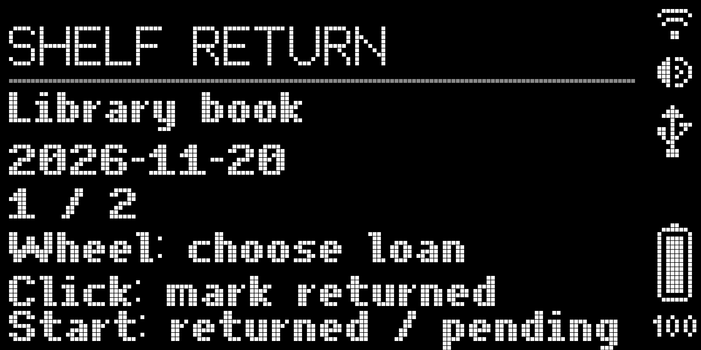

# Shelf Return

Remember loaned items, sort them by due date and mark a real return from the bar.

A shelf full of objects gives little clue which one is due first. Shelf Return puts the nearest outstanding due date first and lets you undo a return if the wrong item was closed.

## Screen transitions

Watch a returned loan move out of the active list and back when you undo it.


<details>

<summary>Watch the rear display</summary>



</details>

## Mark a physical return

1. Enter up to eight loans in device settings using `Item|YYYY-MM-DD` for each, separated by semicolons.
2. Read the item name and date on the rear. The front says **Today**, shows the days remaining or counts days late. Turn the wheel if you need a different loan.
3. Once you have returned the item, click. In the recording the next outstanding due date moves from two days away to eight.


## Reopen a loan closed in error

1. Press **Start** to browse the returned list. Use the wheel to find the item by its name and date.
2. Click to restore it. The returned view shows **All clear** when there are no other closed loans.
3. Press **Start** to return to outstanding loans. The restored item again appears in due-date order.


## Example from the emulator

A book due on the twentieth and a tripod due on the twenty-sixth sort in that order. Returning the book brings the tripod to the front. The countdown uses local calendar days, so the time of day does not shift the due date.

## Run in the emulator

Open BUSY Bar Emulator. From this repository, run:

```sh
~/.busy-emulator/bin/busy-emulator dev --once
```

Press **Back** to exit.

The GIFs are excerpts from the emulator recording. Each LED occupies a 16 × 16 cell with a black border. The end frames pause for reading.

[Full recording](media/controls.mp4) · [Rear display](screenshots/back-1.png) · [Firmware test](EMULATOR-QA.md) · [MIT license](LICENSE)

## Device settings

Open **Apps → Shelf Return → Setup**. Save the fields and reopen the app to use the new values.

- **Loans and due dates** (`loans`). Default: `Library book|2026-11-20;Tripod|2026-11-26`.
